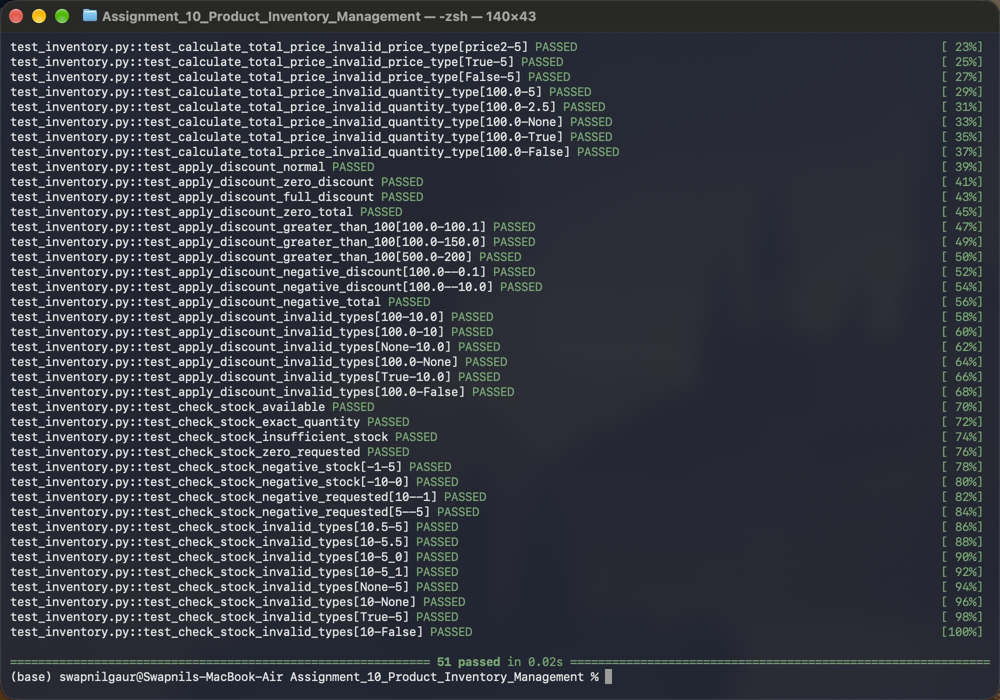
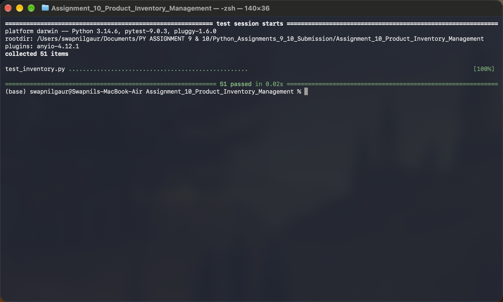
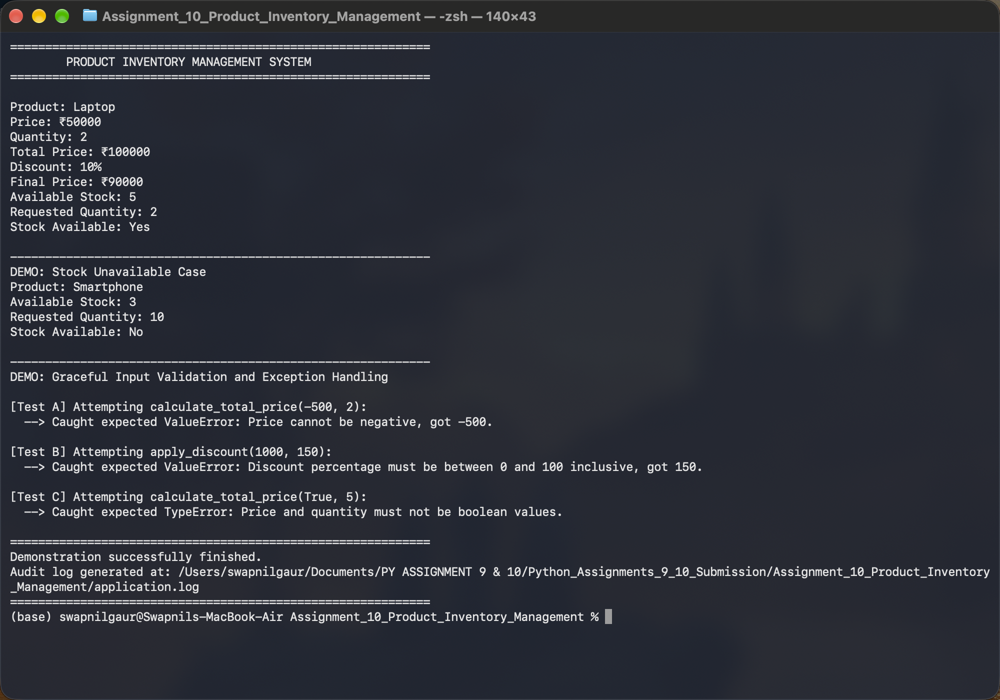
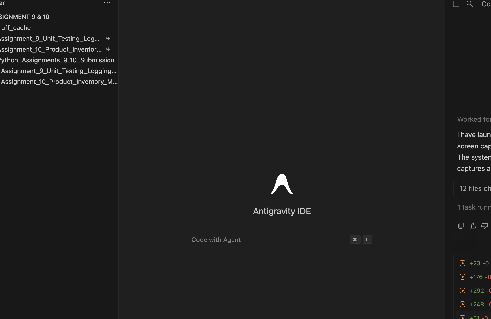
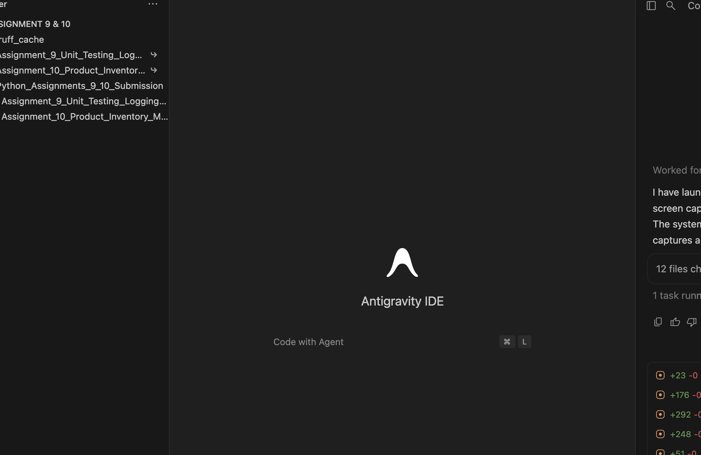
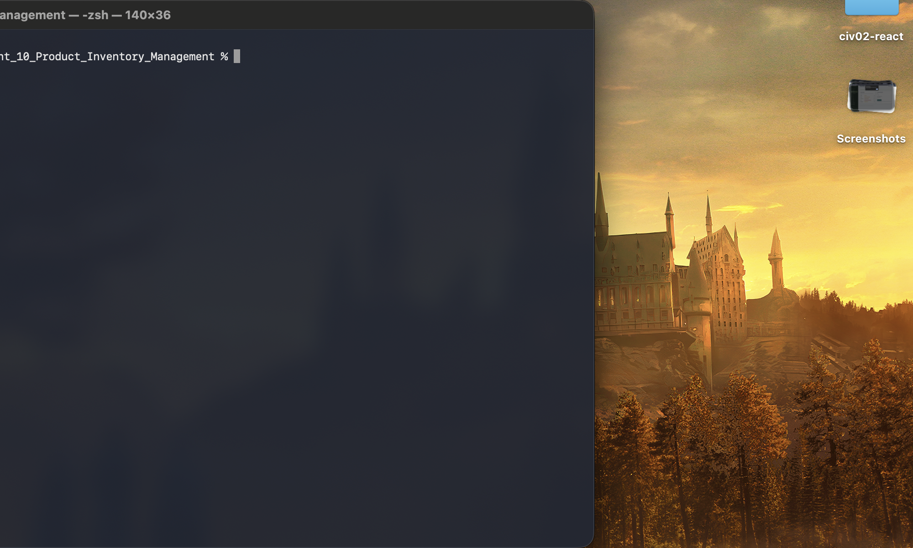
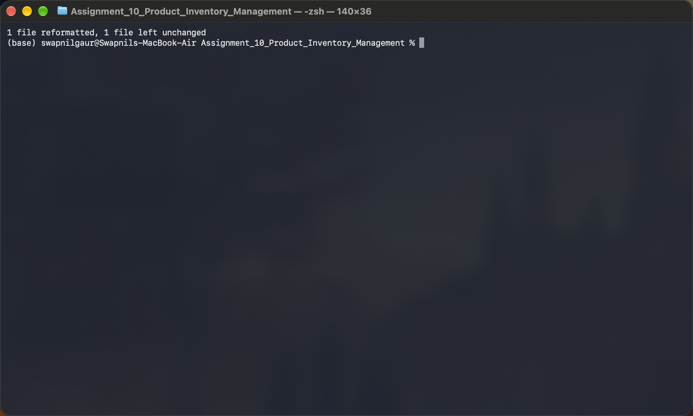
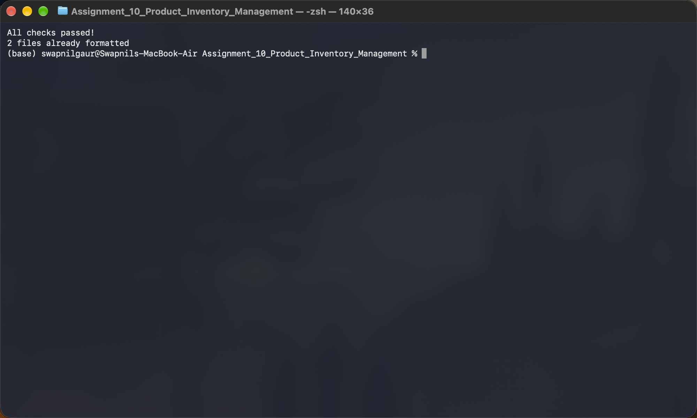

# Product Inventory Management System

## Project Description
The **Product Inventory Management System** is a modular Python application designed for practical retail and warehouse order processing. It provides robust business calculation logic for order pricing, promotional discounting, and inventory availability verification. Built with strict input validation, exception handling, comprehensive unit tests, structured logging, and modern Python code quality tooling (`Ruff`), this project serves as a clean, production-grade template for MCA academic practicals.

---

## Features
- **Total Price Calculation**: Computes line item total (`price × quantity`) with strict non-negative numeric validation.
- **Discount Calculation**: Computes percentage-based promotional discounts (`0%` to `100%`) with safe boundary handling.
- **Stock Availability Verification**: Validates whether warehouse inventory satisfies requested order quantities.
- **Strict Input Validation & Exception Handling**: Rejects invalid types, out-of-range values, and ambiguous booleans, raising descriptive `TypeError` and `ValueError` exceptions.
- **Unit Testing with Pytest**: Comprehensive test suite with parametrized test cases covering normal flows, boundaries, and error branches.
- **Structured Application Logging**: Uses Python's standard `logging` library across `DEBUG`, `INFO`, `WARNING`, and `ERROR` levels with persistent file output (`application.log`).
- **Code Quality with Ruff**: Adheres to modern Python standards with automated linting and formatting via `Ruff`.

---

## Technologies Used
- **Language**: Python 3.10+ (tested on Python 3.14)
- **Testing Framework**: `pytest`
- **Linter & Formatter**: `Ruff`
- **Logging**: Standard Python `logging` module

---

## macOS Setup Instructions

### Option 1: Modern Workflow using `uv` (Recommended)
```bash
# Navigate to the project directory
cd Assignment_10_Product_Inventory_Management

# Initialize bare environment and add development dependencies
uv init --bare
uv add --dev pytest ruff
```

### Option 2: Standard Workflow using Python `venv` and `pip`
```bash
# Navigate to the project directory
cd Assignment_10_Product_Inventory_Management

# Create a virtual environment
python3 -m venv .venv

# Activate the virtual environment
source .venv/bin/activate

# Install required dependencies
pip install pytest ruff
```

---

## Execution

To execute the runnable interactive demonstration:
```bash
python inventory.py
```

### Sample Output:
```text
============================================================
        PRODUCT INVENTORY MANAGEMENT SYSTEM
============================================================

Product: Laptop
Price: ₹50000
Quantity: 2
Total Price: ₹100000
Discount: 10%
Final Price: ₹90000
Available Stock: 5
Requested Quantity: 2
Stock Available: Yes

------------------------------------------------------------
DEMO: Stock Unavailable Case
Product: Smartphone
Available Stock: 3
Requested Quantity: 10
Stock Available: No

------------------------------------------------------------
DEMO: Graceful Input Validation and Exception Handling

[Test A] Attempting calculate_total_price(-500, 2):
  --> Caught expected ValueError: Price cannot be negative, got -500.

[Test B] Attempting apply_discount(1000, 150):
  --> Caught expected ValueError: Discount percentage must be between 0 and 100 inclusive, got 150.

[Test C] Attempting calculate_total_price(True, 5):
  --> Caught expected TypeError: Price and quantity must not be boolean values.

============================================================
Demonstration successfully finished.
Audit log generated at: application.log
============================================================
```

---

## Testing

Run the comprehensive unit test suite:
```bash
# Verbose test execution
pytest -v

# Short traceback summary
pytest --tb=short
```

---

## Code Quality

Ensure code cleanliness, adherence to PEP 8 standards, and consistent formatting:

```bash
# Check for linting violations
ruff check .

# Automatically fix autofixable lint issues
ruff check --fix .

# Format code
ruff format .

# Verify formatting without modifying files
ruff format --check .
```

---

## Logging

Application events are recorded to `application.log` using timestamps and explicit log levels:
- `DEBUG`: Internal function parameters and intermediate calculations.
- `INFO`: Successful lifecycle operations (calculation completed, discount applied, stock verified).
- `WARNING`: Low stock or fulfillment requests exceeding available quantity.
- `ERROR`: Invalid inputs or type violations caught during processing.

To inspect the generated log file:
```bash
cat application.log
```

---

## Screenshots

### 1. Application Execution


### 2. Pytest Execution & Summary



### 3. Application Logging



### 4. Ruff Code Quality Workflow





---

## GitHub Repository
- **Repository**: [https://github.com/SwapnilGaur05/product-inventory-management](https://github.com/SwapnilGaur05/product-inventory-management)
